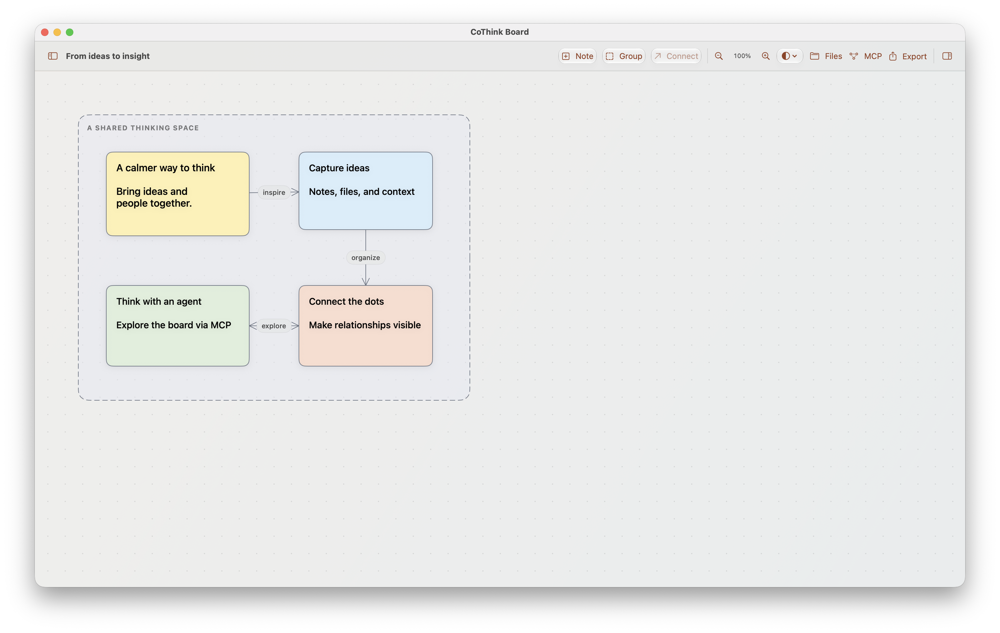
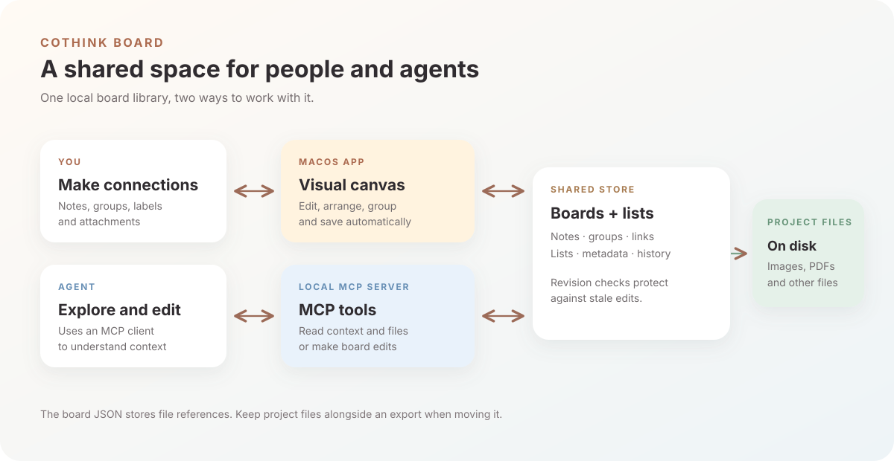

<div align="center">
  
  <h1>CoThink Board</h1>
  <p><strong>A visual space for ideas, built for people and AI agents to think together.</strong></p>
  <p>Native macOS · Local boards · MCP · JSON export</p>
</div>

CoThink Board is a local macOS canvas for notes, relationships, project files, and the context around them. Arrange your ideas by hand, or connect an MCP client so an agent can read the same board, understand its graph, and make edits alongside you.

> CoThink Board เป็นกระดานความคิดบน macOS ที่เชื่อมผู้ใช้และ AI agent ผ่าน MCP โดยเก็บ board และไฟล์โปรเจกต์ไว้ในเครื่อง



*The screenshot uses a demonstration board created for this README.*

## Highlights

- **A flexible canvas:** create notes and groups, drag and resize objects, adjust colors, borders, line styles, and font sizes. The canvas expands to the right and down as content grows.
- **Meaningful connections:** name relationships, choose one-way, two-way, or no arrows, and shape paths as straight lines, curves, or custom bends.
- **Board organization:** create lists of boards with descriptions, tags, flags, and colors. A board can appear in more than one list and also has its own tags, flag, and color.
- **Project files:** keep images, PDFs, and other files in a board's file library; attach them to notes and open them from the canvas.
- **An agent that sees the graph:** the local MCP server exposes notes, groups, connections, labels, directions, positions, attached files, and list context. Agents can also make revision-checked edits.
- **A native macOS workspace:** light, dark, and system appearance; hideable panels; trackpad pinch zoom; keyboard shortcuts; automatic saving; shared undo and redo.
- **Portable board data:** export a board as JSON and import it later. Project file contents and list membership are stored separately; see [Data and backups](#data-and-backups).
- **PDF reports:** preview and export a board using one of three HTML-based templates, with an overview, full note text, relationships, and supported attached images.

## How it works



The app and MCP server use the same local store. An agent first reads the current board or its graph-oriented context, then sends changes with the revision it observed. The store rejects stale changes so they do not silently overwrite a newer edit. The app polls for changes made by other processes.

Connections give an agent explicit endpoints, arrow direction, and any label you add. An unlabeled connection still describes a link, but its meaning must be inferred from the surrounding notes. Reading an attached file requires a separate MCP tool call and a client capable of handling the returned content.

## Get started

### Requirements and build

- macOS 14 or later
- Xcode with the Swift toolchain

From the repository root:

```sh
./scripts/build-app.sh
open 'dist/CoThink Board.app'
```

The script produces a local, unsigned app bundle. macOS may ask for approval when opening it. The application and its bundled `cothink-mcp` executable must use the same storage location to see the same boards.

### Make your first board

1. Choose **New Board** in the sidebar, then use the board settings button or Board inspector to name it.
2. Double-click an empty area of the canvas or select **Note** to add an idea. Double-click a note to edit its text directly on the board; the inspector can edit it too.
3. Drag a note to move it. Select it and drag a corner to resize. Use the inspector to change its fill, border, and font size.
4. Select a note and drag its connection handle onto another note. Alternatively, choose **Connect** and then the target note.
5. Double-click the connection to open its properties. Add a relationship label, choose an arrow direction, and select **Straight**, **Curved**, or **Custom bends**. Drag the handles on the canvas to route curved and custom lines; custom paths also offer **Add bend** and **Remove bend**.
6. Use **Files** to add project files. In a note's inspector choose **Attach from Project**, then click an attachment on the note to open it in its default macOS app.

The left and right toolbar buttons show or hide the boards sidebar and inspector. Clicking empty canvas or another object hides the inspector. Choose **System**, **Light**, or **Dark** in the appearance menu. Primary controls use native Liquid Glass on macOS 26 and later, and translucent system material on older supported versions.

### Select, group, and lock notes

- Drag across an empty area to select notes; this does not create a group by itself. Choose **Group** to group the selection, or choose **Group** first and draw its bounds. Notes whose centers are inside a newly drawn group become locked members.
- Dragging a group or one of its locked notes moves the group and its members together.
- In a note's inspector choose **Unlock from group** to move it independently. Choose **Lock to group** to lock that individual note to a group again, keeping its current position. A note can be locked to one group at a time.
- For an existing group, **Lock notes inside group** locks notes whose centers are inside its bounds. A group without locked member IDs is a visual background until members are locked to it.

### Organize boards into lists

Choose the folder button in the sidebar to manage lists. Each list has a title, description, tags, flag, color, and a selection of boards. Choose a list, make changes, and select **Save**. Use the × button or Escape to close the manager. Deleting a list leaves its boards intact; deleting a board removes it from lists. Use the board settings button to edit a board's own name, tags, flag, and color.

### Export a PDF

Choose **Export → Export as PDF…**, select a template, check the preview, and choose **Save PDF…** to select a destination. The three designs are:

- **Editorial:** warm paper and a serif title.
- **Studio:** a navy header and a two-column note layout.
- **Minimal:** a restrained black-and-white layout for printing.

Each A4 PDF includes a scaled canvas overview followed by full note text, project-file names, supported image attachments, and connection labels and directions. The overview abbreviates note text; the complete text appears in the notes section. Attached images are included up to 5 MB each and 20 MB in total. Missing, unsupported, or oversized images are identified in the report. Other attachments are listed by name and are not embedded. PDF is a presentation format; use JSON export to import and edit a board later.

## Connect an AI agent with MCP

CoThink includes a **local stdio MCP server** in the app bundle. Build the app, open it, and choose **MCP** in the toolbar to copy a configuration for its current location. An example configuration for a client that accepts the `mcpServers` format:

```json
{
  "mcpServers": {
    "cothink": {
      "command": "/absolute/path/CoThink Board.app/Contents/MacOS/cothink-mcp",
      "env": {
        "COTHINK_MCP_ACTOR": "my-agent"
      }
    }
  }
}
```

Replace the command with the absolute path on your Mac and follow your client's MCP configuration instructions. Reconnect the client after updating the bundled server so it discovers the latest tools.

### A practical agent workflow

1. Call `list_boards` and, if useful, `list_board_lists` to find the right board and its list context.
2. Call `get_board_context` with `board_id` to read the graph: notes, groups, connections, labels, arrow directions, route points, positions, attached asset IDs, and lists. `get_board` returns the complete board and revision.
3. Call `read_project_file` with `board_id` and an `asset_id` to inspect an item in the board's project library. Use `read_note_image` for an image attached directly to a note through the older image attachment field.
4. To edit, call `edit_board` with the board's current `expected_revision` and an ordered array of operations. If the revision is stale, read the board again and reconcile the changes before retrying.
5. Use `board_history` to see attribution and revisions, or `undo` / `redo` to travel the board's shared history.

For example, to label and route an existing connection, an MCP client can call `edit_board` with arguments shaped like these (replace the example IDs and revision with values from your board):

```json
{
  "board_id": "your-board-id",
  "expected_revision": 12,
  "operations": [
    {
      "action": "update",
      "collection": "connections",
      "id": "your-connection-id",
      "fields": {
        "label": "supports",
        "direction": "oneWay",
        "route": "custom",
        "routePoints": [{ "x": 420, "y": 260 }, { "x": 620, "y": 260 }],
        "fontSize": 14
      }
    }
  ]
}
```

`route` is `straight`, `curved`, or `custom`. Route points use board coordinates: a curve uses its first control point; a custom path uses its points as bends. The server supplies a default point for a curved or custom route without saved points. Notes, group titles, and connection labels support `fontSize` from 6 to 96.

### MCP tools at a glance

| Task | Tools |
| --- | --- |
| Find and understand boards | `list_boards`, `get_board`, `get_board_context`, `board_history` |
| Create and edit boards | `create_board`, `edit_board`, `replace_board`, `import_board`, `delete_board` |
| Organize lists | `list_board_lists`, `create_board_list`, `update_board_list`, `delete_board_list`, `set_board_metadata` |
| Work with files and PDF | `add_project_file`, `read_project_file`, `read_note_image`, `export_board_pdf` |
| Lock and unlock a note | `lock_note`, `unlock_note` |
| Travel shared history | `undo`, `redo` |

Existing-board mutations require `expected_revision`; list updates and deletion use their own list revision. `edit_board` supports ordered `rename`, `add`, `update`, and `delete` operations across notes, groups, connections, and assets. The server publishes input schemas and field details through `tools/list`. `lock_note` transfers a note from its previous group if necessary, without changing its position.

`export_board_pdf` writes a PDF snapshot to an absolute `destination_path`. Supply `board_id`, `expected_revision`, and a `template` of `editorial`, `studio`, or `minimal`; set `overwrite` to `true` only when replacing an existing file. The tool requires a macOS graphical session and the bundled `cothink-pdf` helper. It writes to the local filesystem and is disabled in MCP read-only mode.

### File access and configuration

`read_project_file` reads registered assets within the board's project folder, up to 50 MB per file. It returns images as MCP image content and extracts UTF-8 text or selectable PDF text. Extracted text is limited to 100,000 characters. A PDF without selectable text is rendered as images for up to its first eight pages. Other formats are returned as an embedded MCP resource; whether an agent can interpret that content depends on its client and model. The older `read_note_image` tool reads the image path recorded directly on a note and has the same file size limit.

| Environment variable | Purpose |
| --- | --- |
| `COTHINK_HOME` | Overrides the local storage directory. Set the same value for the app and MCP server to share boards. |
| `COTHINK_MCP_ACTOR` | Sets the actor name recorded for MCP changes; defaults to `agent`. |
| `COTHINK_MCP_READ_ONLY=1` | Rejects write tools for that server process. |

Read-only mode is client configuration, not an authentication or security boundary against other local processes. Connected clients can access the board data and supported file content exposed by the server.

## Data and backups

By default, the app stores its database and history in `~/Library/Application Support/CoThinkBoard/`. Project files default to `~/Library/Application Support/CoThinkBoard/Projects/<board-id>/`; a board can also use a folder you choose in **Files**.

**Export as JSON** writes the current board as JSON, including its notes, connections, groups, and project-file metadata. It does not embed project-file contents, list membership, undo history, or change attribution. A board can also contain local file paths. Keep the project folder with the JSON when backing up or sharing it, and check the project-file location after import. Import creates a separate board with a new ID; it does not bundle or automatically copy the files.

## Keyboard shortcuts

| Action | Shortcut |
| --- | --- |
| New note | ⌘N |
| New board | ⇧⌘N |
| Group selection or draw a group | ⇧⌘G |
| Connect selected note, then click target | ⌘L |
| Zoom in / out | ⌘+ / ⌘− |
| Zoom on the canvas | Pinch in / out on the trackpad |
| Actual size | ⌘0 |
| Delete selected object while canvas has focus | Delete |
| Delete selected object from the menu | ⇧⌘Delete |
| Undo / redo | ⌘Z / ⇧⌘Z |
| Show or hide boards | ⌥⌘1 |
| Show or hide inspector | ⌥⌘2 |
| Export board | ⇧⌘E |
| Cancel connection | Escape |

## Development and current limits

```sh
swift test
python3 scripts/test-mcp.py
# Optional PDF export integration check, in a macOS graphical session:
COTHINK_TEST_PDF=1 python3 scripts/test-mcp.py
```

The canvas grows right and down from its top-left origin. Sidebar search matches board titles, tags, and note text; it does not highlight matches. There is no semantic search tool or in-app agent permission management. Undo and redo share board history across users and agents. The app is unsigned and has not been notarized or packaged as a signed distribution.
